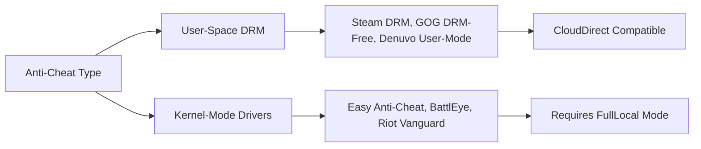

# VYDRIX 2.0 — Cloud-First Game Compatibility Matrix & Architecture

**Date:** 2026-10-24  
**Architecture Version:** VYDRIX 2.0 (Storage-Negative)  
**Status:** Approved Reference Standard  
**Scope:** Windows 11 / WinFsp / Rclone / PC Gaming Ecosystem

---

## 1. Principles of Cloud-First Gaming on Windows

VYDRIX allows Windows PC games to execute with game files hosted authoritatively in cloud storage, streamed on-demand through a virtual drive (`G:`), while keeping local disk footprint at or near zero.

### Core Rules
1. **Never Bypass DRM, Anti-Cheat, or Launcher Verification:**
   VYDRIX is a transparent virtual file-system engine, not a crack or DRM circumvention tool. Games must validate through legitimate storefronts (Steam, Epic, GOG, EA, etc.).
2. **Authoritative Cloud Originals:**
   Game binaries and asset archives reside in the cloud. Local storage is strictly a transient cache.
3. **Never Auto-Delete Local Installations:**
   When migrating a local game to the cloud, the local copy is retained until the cloud upload is verified with size and hash checks, and explicit user confirmation is given.
4. **Synthetic Testing First:**
   All streaming verification must be performed with synthetic benchmarks and harmless open-source demo titles before attempting complex commercial games.

---

## 2. Windows I/O & Filesystem Compatibility Matrix

The table below defines how Windows I/O subsystems behave across virtual cloud drives (`WinFsp` + `rclone VFS`) and their technical compatibility:

| Windows I/O Subsystem | Technical Mechanism | WinFsp / VFS Full Cache | VFS Off / RAM-Only | Compatibility Assessment & Mitigations |
| :--- | :--- | :---: | :---: | :--- |
| **Byte-Range Reads** | `ReadFile` at arbitrary file offsets | **Supported** | Supported | Chunks stream on-demand via HTTP range requests (`Range: bytes=X-Y`). |
| **Random Backwards Seeks** | `SetFilePointerEx` backwards | **Supported** | Limited | Unreal `.pak` and Unity asset bundles seek backwards frequently. Supported cleanly in `Full` cache mode via sparse files. |
| **Memory-Mapped I/O** | `CreateFileMapping` / `MapViewOfFile` | **Supported** | **Fails** (`ERROR_NOT_SUPPORTED`) | Executable binaries (`.exe`, `.dll`) and paging require local sparse caching. `Full` mode maps pages seamlessly. |
| **Executable Launch** | `CreateProcessW` (`SEC_IMAGE`) | **Supported** (`file-perms 0777`) | **Fails** (`ERROR_ACCESS_DENIED`) | Requires execute permissions in WinFsp ACL mapping (`--file-perms 0777`). Essential startup files must be warm or cached. |
| **File Sharing & Locks** | `FILE_SHARE_READ`, `LockFileEx` | **Supported** | Partial | WinFsp handles Win32 file sharing semantics locally. Multi-process access supported within single PC session. |
| **Timestamps & Attributes** | `SetFileTime`, `GetFileInformationByHandle` | **Supported** | Limited | VFS metadata tracks modtimes. Remote modtime writeback queued asynchronously. |
| **Case-Insensitive Lookups** | Windows case-folding | **Supported** (`dir-cache-time 30m`) | Supported | Rclone builds case-insensitive in-memory directory cache. |
| **Sparse File Allocation** | `FSCTL_SET_SPARSE` / `FSCTL_SET_ZERO_DATA` | **Supported** (NTFS) | N/A | Cached chunks occupy only physical downloaded bytes; untouched ranges consume 0 disk bytes. |

---

## 3. Storefront & Launcher Compatibility

| Launcher / Storefront | Cloud-Direct Compatibility | Observed Behavior | Recommended Execution Mode |
| :--- | :---: | :--- | :--- |
| **GOG (DRM-Free Standalone)** | **Excellent (95%)** | Standalone executables run directly off `G:\Games\GameTitle\`. No background launcher required. | `CloudDirect` |
| **Steam** | **Good (80%)** | Steam allows adding external games or mounting Steam Library folders. Steam verification checks checksums: fast on cached files, high network usage if uncached. | `CloudDirect` or `HybridOptimized` |
| **Epic Games Store** | **Moderate (65%)** | Epic launcher verifies `.egstore` manifest before launching. Manifest files must remain local or pinned. | `HybridOptimized` |
| **EA App / Ubisoft Connect** | **Moderate (60%)** | Requires proprietary background service launcher. Executable handoffs require tracking child process trees via Windows Job Object. | `HybridOptimized` |
| **Xbox App / Microsoft Store** | **Incompatible (0%)** | Games run inside encrypted UWP / EFS virtualization containers with strict kernel driver requirements. | `FullLocal` (Ineligible for Cloud Direct) |

---

## 4. Anti-Cheat & DRM Compatibility Matrix

Kernel-mode anti-cheat systems inspect the underlying volume driver and memory structures:

| Anti-Cheat / DRM Technology | Detection / Protection Level | Virtual Drive (`G:`) Compatibility | Technical Reason & Required Policy |
| :--- | :---: | :---: | :--- |
| **DRM-Free (GOG, Itch.io, Freeware)** | None | **100% Compatible** | No volume inspection; pure Win32 file reads. |
| **Steam Stub / Custom User DRM** | User-Mode | **90% Compatible** | Validates license through Steam client IPC. Fully compatible. |
| **Denuvo Anti-Tamper** | User-Mode VM | **75% Compatible** | Obfuscated code execution; works in `Full` cache mode if CPU instruction timing is stable. |
| **Easy Anti-Cheat (EAC)** | Kernel Driver (`.sys`) | **Limited (35%)** | EAC checks file integrity via kernel callbacks. May report `Untrusted system file` if WinFsp driver is blocked. |
| **BattlEye** | Kernel Driver (`.sys`) | **Limited (30%)** | Similar to EAC; block-level file access must be cached or local. |
| **Riot Vanguard / Ricochet** | Ring 0 Kernel Hypervisor | **0% Incompatible** | Rejects virtual drives and non-standard volume filter drivers. Must be installed locally. |

---

## 5. Saves, Shader Caches, and User-Generated Content

A critical rule of VYDRIX 2.0 is that **user saves must NEVER be at risk**:

1. **Save Game Locations:**
   Almost all modern Windows games write saves to:
   - `%USERPROFILE%\Saved Games\<Game>`
   - `%LOCALAPPDATA%\<Studio>\<Game>\Saved\`
   - `%APPDATA%\<Game>\`
   - `%USERPROFILE%\Documents\My Games\<Game>`
   *VYDRIX Impact:* Because these paths reside on the user's primary local profile (outside `G:` and outside VYDRIX cache), **game saves are completely unaffected by cache purges or cloud unmounts**.
2. **Shader Caches:**
   DirectX 12 and Vulkan shader pipeline caches are written by GPU drivers directly into:
   - NVIDIA: `%LOCALAPPDATA%\NVIDIA\DXCache`
   - AMD: `%LOCALAPPDATA%\AMD\DxCache`
   *VYDRIX Impact:* Shaders compile to local GPU driver folders; zero performance penalty on virtual drive.
3. **In-Directory Game Saves (Retro / Legacy titles):**
   Some legacy titles save into their own install folder (e.g. `G:\Game\save01.dat`).
   *VYDRIX Safety Guard:* VYDRIX's `SmartCacheManager` strictly identifies `Dirty` files (files with pending uploads to cloud) and **never evicts them** until the cloud upload has completed successfully.

---

## 6. Provider Limits & Throttling Mitigation

| Cloud Provider | API TPS Limit | Bandwidth Quotas | VYDRIX Mitigation Strategy |
| :--- | :---: | :---: | :--- |
| **Google Drive** | 10 requests / sec | 750 GB / day upload | `--tpslimit 10`, Exponential backoff on HTTP 403/429 (`UserRateLimitExceeded`), RC statistics monitoring. |
| **Microsoft OneDrive** | Variable rate | Throttling on rapid listing | `--dir-cache-time 30m` minimizes metadata requests. |
| **Amazon S3 / Backblaze B2** | Unlimited TPS | Pay-per-egress | Adaptive sliding window caching minimizes repeated egress costs. |
| **SimCloud (Offline Simulator)** | Configurable | Simulated network latency | Deterministic unit & integration testing without external internet dependencies. |

---

## 7. Migration & Upload Safety Protocol

When a user elects to offload a local game to the cloud:
1. **Directory Inspection:** Verify folder contents and scan with `StorageReclamationAdvisor`.
2. **Staged Cloud Upload:** Copy data to the remote cloud destination using verified rclone transfers.
3. **Checksum Verification:** Compare MD5/SHA-256 hashes or file sizes across cloud and local files.
4. **Original Preservation:** The local original is **never** deleted automatically. The user is prompted with a clear summary:
   > *"Upload of [Game Title] (18.4 GB) to Google Drive verified. Local copy remains at [Path]. Would you like to keep the local copy as a backup or reclaim this space?"*
5. **Rollback Availability:** The user can instantly restore or keep their local files at any time.
