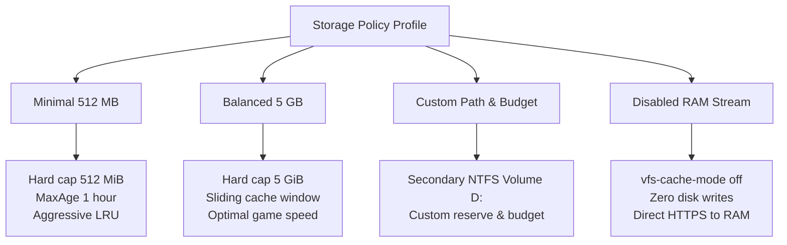
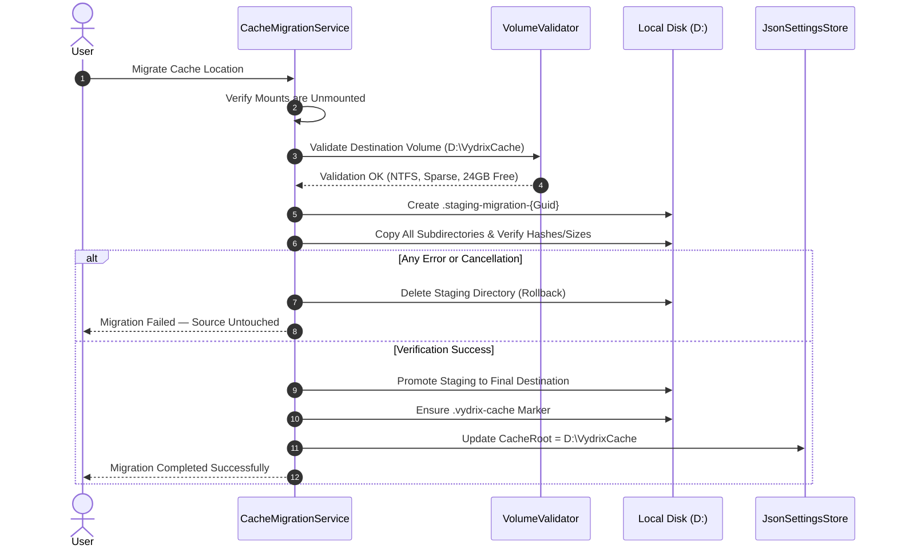
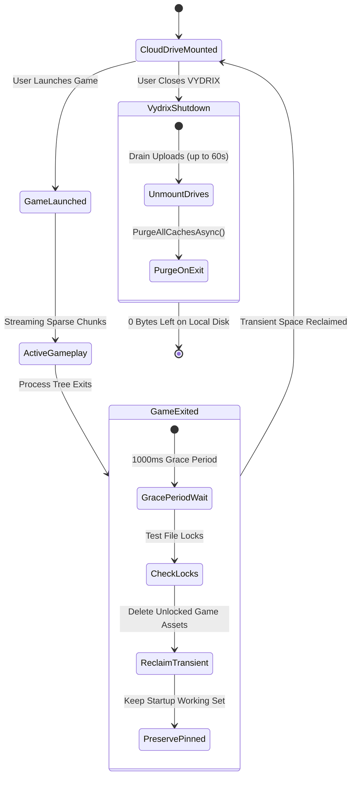

# VYDRIX 2.0 — Zero-Footprint Mode & Storage Policy Specification

**Date:** 2026-10-24  
**Architecture Version:** VYDRIX 2.0 (Storage-Negative)  
**Status:** Approved & Implemented  
**Target Platform:** Windows 11 (x64)

---

## 1. Vision and Objective

The fundamental premise of VYDRIX 2.0 is:

> **Keep supported files in cloud storage, access them through a virtual drive, and use the minimum possible local storage without corrupting data or breaking active reads.**

Prior to VYDRIX 2.0, rclone defaulted to `--vfs-cache-mode full` with a 30-day data retention policy on the Windows system drive (`C:`), causing gigabytes of local storage accumulation.

**Zero-Footprint Mode** provides user-configurable storage policies that eliminate persistent local SSD wear and disk bloat, enabling gamers to play from the cloud while keeping their local SSD usage strictly bounded or completely self-purging.

---

## 2. Storage Policy Profiles

VYDRIX 2.0 introduces four discrete Storage Policy Profiles (`CachePolicyProfile`):



### Profile Comparison Matrix

| Storage Profile | Cache Mode | Hard Budget | Max Data Age | Auto-Purge on Exit | Local Disk Allocation | Compatibility Profile |
| :--- | :--- | :---: | :---: | :---: | :--- | :--- |
| **Minimal** | `Full` (Sparse) | **512 MiB** | 1 Hour | Optional | **< 512 MB temporary** | 100% PC Games & Apps |
| **Balanced** *(Default)* | `Full` (Sparse) | **5 GiB** | 7 Days | Optional | **Sliding window up to 5 GB** | 100% PC Games & Launchers |
| **Custom** | `Full` / User | User Defined | User Defined | Configurable | Bound to User Budget | 100% PC Games |
| **Disabled** | `Off` | **0 Bytes** | N/A | Immediate | **0 Bytes (RAM only)** | Media, ROMs, Sequential reads |

---

## 3. Cache Disabled Mode (`--vfs-cache-mode off`): Technical Realities & Limitations

When `Profile == Disabled` or `CacheMode == Off`:
- Rclone runs with `--vfs-cache-mode off`.
- The cache directory is omitted or left completely unpopulated.
- All reads stream directly over HTTPS into in-memory RAM buffers (`--buffer-size 64Mi`).

### Supported Workloads in Disabled Mode
- **Sequential Streaming:** Video playback (`mpv`, VLC), audio tracks, media libraries.
- **Document Viewing:** PDFs, images, archives decompression.
- **Emulators & Retro ROMs:** Emulators that read full ROMs sequentially into memory.

### Limitations & Game Incompatibilities
1. **Memory-Mapped Executables (`MapViewOfFile` / `SEC_IMAGE`):**
   Windows `CreateProcess` requires file system paging support. WinFsp cannot satisfy `PAGE_EXECUTE_READ` page-faults on unbuffered remote streams. Native `.exe` and `.dll` binaries will fail with `ERROR_ACCESS_DENIED` or crash.
2. **Out-of-Order / Backwards Seeks:**
   Game archives (Unreal `.pak`, Unity `.assets`) make frequent non-sequential seeks. When seeking backwards across unbuffered streams, network streams reset or throw I/O errors.
3. **Concurrent Read/Write:**
   Files cannot be opened for read and write simultaneously.

*Guideline:* For PC gaming, **Minimal Mode (512 MiB hard cap)** or **Ephemeral Auto-Purge** must be used instead of Disabled Mode.

---

## 4. Secondary Volume Support (NTFS / ReFS Validation)

VYDRIX 2.0 allows users to designate cache locations on secondary volumes (e.g. `D:\VydrixCache` or `E:\VydrixCache`).

### Validation Requirements (`VolumeValidator.cs`)
Before activating any cache directory, VYDRIX enforces strict validation:
1. **NTFS / ReFS Sparse File Support:**
   The volume must support `FILE_SUPPORTS_SPARSE_FILES`. If formatted as FAT32, exFAT, or network shares, partially downloaded files would allocate 100% of their logical size on disk immediately, destroying storage savings.
2. **Zero Silent Fallback to `C:`:**
   If a user configures `D:\VydrixCache`, VYDRIX will **never** silently fall back to `C:\Users\...\AppData\Local\Vydrix\cache` if `D:` is missing or permissions fail. It alerts the user and halts mounting until resolved.
3. **Write Permission Verification:**
   Performs a non-destructive write test probe before accepting the path.
4. **Reserve Space Accounting:**
   Verifies that available free space satisfies `RequestedBudget + MinFreeSpaceReserve`.

---

## 5. Safe Cache Migration with Validation and Rollback

When a user moves their cache location (e.g., from `C:` to `D:`), `CacheMigrationService` executes a transactional staged migration:



---

## 6. Rclone-Compatible Cache Management

### The Defect in Legacy VYDRIX
Legacy versions directly called `File.Delete()` on live files inside `vfs` and `vfsMeta` while rclone was running. This desynchronized rclone's in-memory chunk map, leading to `ERROR_FILE_NOT_FOUND`, corrupted downloads, or lost pending uploads.

### VYDRIX 2.0 Rclone-Compatible Protocol
1. **Dynamic Runtime Limits (`rclone rc options/set`):**
   When the cache budget is reduced or maintenance triggers, VYDRIX dynamically dispatches:
   ```json
   {
     "vfs": {
       "CacheMaxSize": 536870912,
       "CacheMaxAge": 3600000000000
     }
   }
   ```
   Rclone's internal thread-safe eviction engine safely prunes unlocked LRU files.
2. **Queue Protection (`rclone rc vfs/stats` & `vfs/queue`):**
   Files are never removed while `uploadsInProgress > 0` or `uploadsQueued > 0`.
3. **Explicit Invalidation (`vfs/forget`):**
   Before any offline or targeted chunk is cleared, `vfs/forget` is called to notify rclone's cache index.
4. **Lock Testing (`IsFileLocked`):**
   File streams are checked with exclusive lock probes before deletion.

---

## 7. Hard-Budget Enforcement & Capacity Exhaustion

When the hard cache budget (e.g. 512 MiB) is reached:
1. `DiskSafetyGuard` recalculates pressure.
2. If all candidate files are pinned, locked, or active in running game sessions:
   - Prefetching is immediately paused.
   - `IsCapacityExhausted` becomes `true`.
   - VYDRIX displays an actionable alert:
     > *"Cache capacity exhausted (512 MB / 512 MB). All cached files are active, pinned, or locked. Close running games or increase cache budget."*
   - VYDRIX blocks speculative downloads rather than silently overflowing the user's disk budget.

---

## 8. Ephemeral Mode & Game-Aware Reclaim Lifecycle



1. **Game Process Exit:** When the monitored process tree completes, VYDRIX enters a 1-second grace window to let OS file buffers flush.
2. **Transient Reclaim:** Assets unique to that game session are purged, leaving pinned and learned startup blocks.
3. **Shutdown Purge:** When `PurgeCacheOnExit` is enabled, all cached files are cleared upon unmounting, leaving **0 bytes on the user's disk**.
